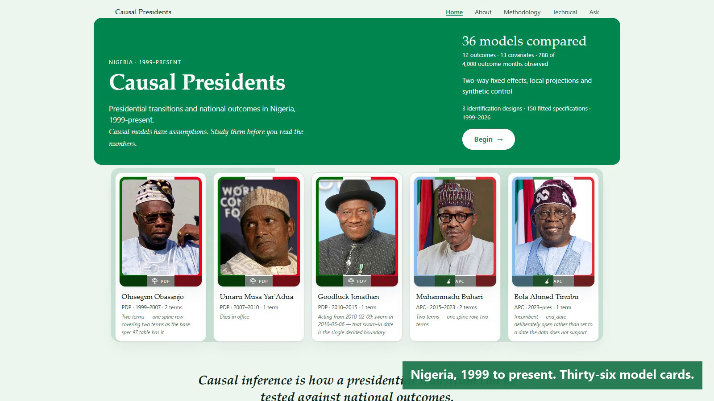
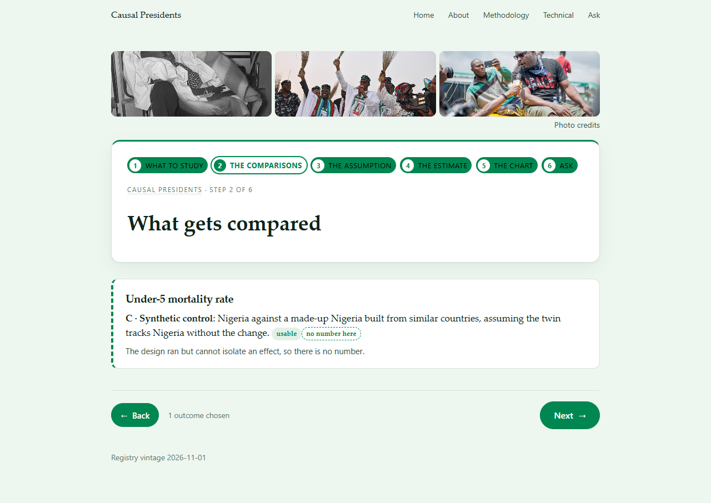
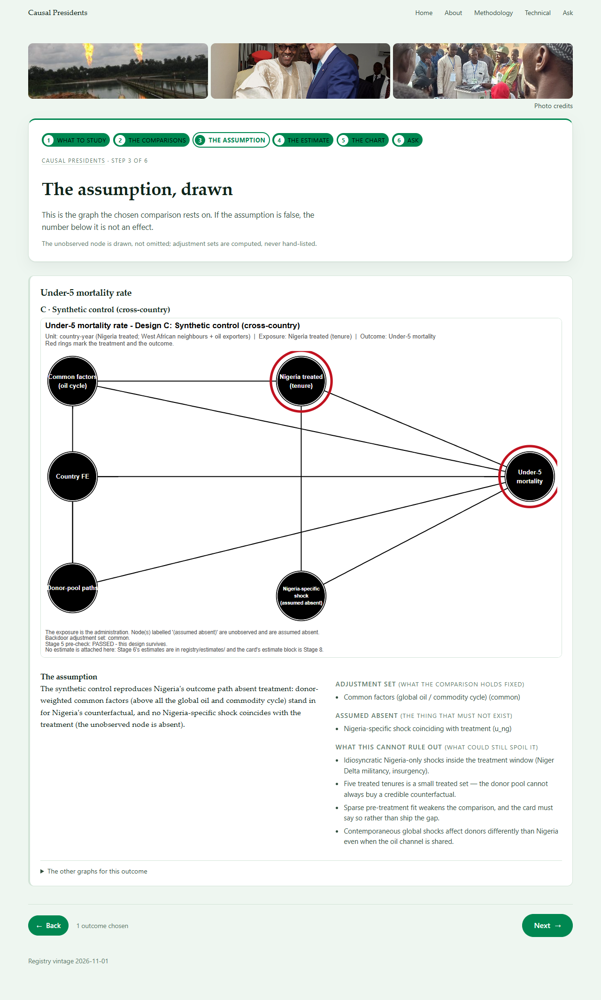
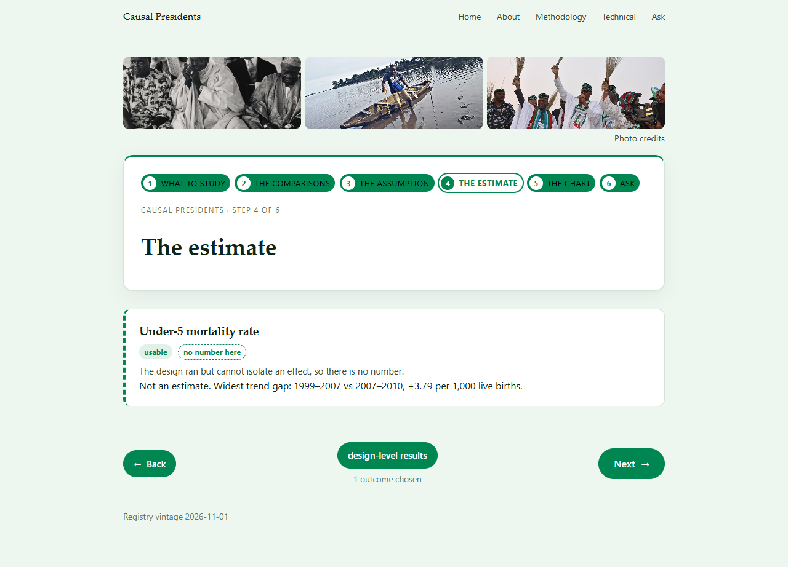
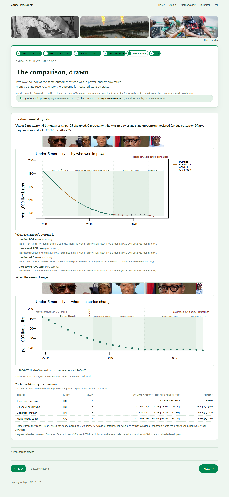
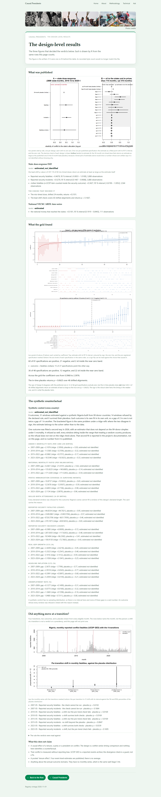
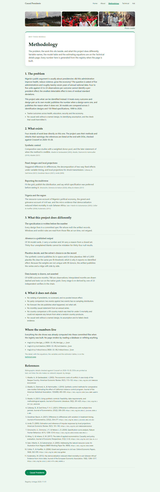
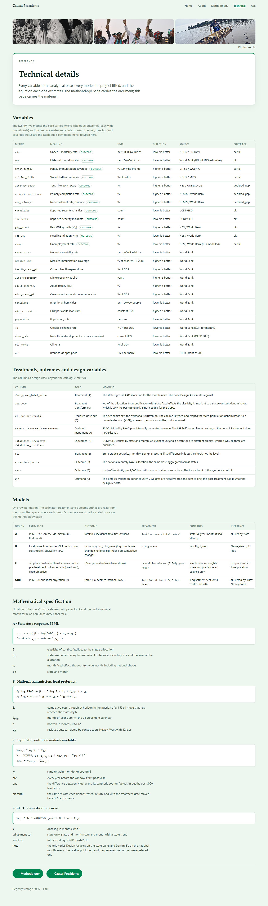

# Causal Presidents

**Regime and national outcomes in Nigeria, 1999–present — an interactive causal-inference explorer.**

Visitors will ask causal questions of a model *and* open the fitted models behind the answers:
coefficient tables, intervals, diagnostics and sensitivity bounds.

> **Presidents are one input, not the cause.** Presidential influence on Nigerian outcomes is heavily
> mediated by oil price cycles, state governments, donor funding and inherited conditions. This project
> is built to show those confounders rather than hide them, and it reports adjusted **associations** —
> never an unconditional causal fact. Where the design cannot identify an effect, it says so.

---

## Demo

**Live:** <https://batestguy.github.io/causal-presidents-regime-Naija/>

It is an installable web app, not just a page: open it on a phone and use **Add to Home Screen** (Safari) or
**Install app** (Chrome), and it opens full-screen and works with the network off. The whole site is about
5 MB and the service worker precaches every page, figure and JSON file at build time.

[](docs/demo/demo.mp4)

▶ **[Watch the 1:37 demo](docs/demo/demo.mp4)**: a real walk through the site — the two outcomes ticked on
the study screen, the comparison, the graph, the refused cards, the chart's grouping switch and tenure table,
the published card with its technical section opened, the design-level results, and the Ask box answering a
question. Captured at 1600×900 on the built site, navigation and scrolling included. Music: *Nobody Fails* by
Ofege, from 0:19. The recorder and the builder are in `tools/`.

The screenshots below are frame by frame: no server, no database, no network call at render time.

<table>
  <tr>
    <td width="50%"><br><em>Home: the premise, the five administrations, and the counts</em></td>
    <td width="50%"><br><em>Step 1: choose outcomes, with each one's coverage stated</em></td>
  </tr>
  <tr>
    <td><br><em>Step 2: what gets compared, assuming what</em></td>
    <td><br><em>Step 3: the assumption, drawn, with the adjustment set</em></td>
  </tr>
  <tr>
    <td><br><em>Step 4: the estimate, two lines a card</em></td>
    <td><br><em>Step 5: the series, its breaks, and each tenure against the trend</em></td>
  </tr>
  <tr>
    <td><br><em>The design-level results: forest plot, grid, synthetic counterfactual, transitions</em></td>
    <td><br><em>Ask: a gated answer, plain first, technical collapsed</em></td>
  </tr>
  <tr>
    <td><br><em>Methodology: the rules, what it does not claim, where the numbers live</em></td>
    <td><br><em>Technical: estimators, adjustment sets, every published coefficient</em></td>
  </tr>
  <tr>
    <td colspan="2"><br><em>About: the provenance rule, and the two-note limit</em></td>
  </tr>
</table>

---

## Status: frozen at vintage 2026-11-01 — Stages 0–9 complete, the chain verified end to end, and the registry carries two numbers with a reason for every other card

> **The headline finding (2026-10-18): an oil-price shock reaches Nigeria's states, federal money does not
> visibly buy peace, and the tenure question has one answerable half.** A 10 % rise in Brent reaches state allocations as roughly **5 % more money, two
> to three months later** (cumulative elasticity +0.518 at h=2, HAC SE 0.166; C-48), and that sign holds in
> **all 24** specifications of the robustness grid — though the *timing* is its weak part: an in-time
> placebo across 48 shifted alignments returns p = 0.0625. The state dose-response question *can* be
> estimated — 3,888 state-months — and **cannot be identified** from this dose: a mis-timed dose fits just
> as well, because what survives the fixed effects is the 13 % derivation share moving with the oil price
> (C-47). Asked 81 ways, **its sign survives most of the grid** — 60 positive against 21 negative — and the
> check that still fails is the lead-shift placebo, not the grid (C-82). The presidential-tenure question is **not answerable at all**
> from 4–5 administrations and 27 annual observations — though **the timing half of it is answerable**: on
> the one monthly outcome, two of eight transition-outcome cells survive both the placebo and the pre-trend
> check (`registry/events/2026-10-18/`). And the synthetic-control design that could not be built is no
> longer blocked on data: widening the donor pool from 13 countries to **99** took it from `infeasible` to
> passing its pre-fit gate on `u5mr` (3 of 4 windows). Full write-ups:
> [`docs/estimates.md`](docs/estimates.md), [`docs/robustness.md`](docs/robustness.md) and
> [`docs/events.md`](docs/events.md) — and the boundary all three sit inside,
> [`docs/limitations.md`](docs/limitations.md).

**Since the freeze (2026-11-04).** Two passes ran outside the registry's numbers, and no published figure
moved. The causal first pass replaced Design C's 99-donor simplex with a matrix-completion counterfactual,
fitted it on under-5 mortality against 99 placebos, and **stopped at its own gate**: every window's gap sits
inside the range that treating a random country produces, so `mmr` and `unemp` were not fitted and no what-if
number is published ([`docs/causal-phases.md`](docs/causal-phases.md), `PROGRESS.md`). The presentation pass
then cut the estimate screen from 1,048 visible words to 513, put the refusal on three screens, and made the
site an installable offline app. The registry is still vintage 2026-11-01, and **no published number
changed**; the card layer was regenerated on the same day to carry a description block on the Design C cards
(the tenure trend's widest contrast in years, and the changepoint search's result), which is derived from the
tenure and changepoint artifacts and verified against them.

| | |
|---|---|
| Specification | ✅ Complete (`nigeria-causal-inference-spec.md`, `PHASES.md`) |
| Ingestion | ✅ **Five** sources working, provenance-verified: 22 national indicators + a **99-country** synthetic-control candidate panel + the Brent crude oil series + 174 FAAC disbursement documents (the state fiscal dose) + the UCDP GED security events (the state-attributed outcome — **keyless**, C-45) |
| Assumption layer | ✅ **36 causal graphs** — 3 identification designs × 12 outcomes, with the adjustment set computed from each graph |
| Quality gates | ✅ **Stage 3** — 5 gates over **1,070 series**: 577 ok, 491 flagged, 2 empty, 0 silently dropped (the donor pool's 891 country-series — 9 series × 99 countries — join the 37 FAAC ones and the 117 UCDP scopes; the 2 empty are `Eritrea`/`Somalia` CPI, which the source has no data for). `flagged` is published on every series and travels into the base |
| Analytical base | ✅ **Stage 4** — one monthly table, 8,350 rows (25 metrics × 334 months), index-anchored, with the party-by-tenure strata, the Stage 3 quality status and the 37 × 334 state panel carrying both the dose and the outcome |
| Pre-analysis diagnostics | ✅ **Stage 5** — every design validated before estimation, **re-run at vintage 2026-11-01** after the donor pool was widened from 13 countries to **99 candidates** and the panel grew to nine country-year series. **3 of 36 cards pass their pre-check** — `u5mr`, `mmr` and `unemp` under Design C (15 fail, 9 degraded, 9 not attempted): Family A dropped on the dose *axis* (per capita waits on X-09) with the outcome blocker now cleared, B degraded (annual grain, a 38–99 SD detectable effect), and **C now runs for every outcome the panel carries** — `u5mr` 3 of 4 windows, `mmr` 2 of 3, `unemp` 3 of 4, while `immun_penta3`, `gdp_growth` and `cpi_yoy` fail the gate and `skilled_birth` has no runnable window — under a **declared strict-majority rollup** and the caveat that a 99-donor simplex can fit almost any pre-period |
| Estimation | ✅ **Stage 6** — 21 specifications across two designs (3 Design A outcomes; Design B\u2019s 9 horizons on each of two outcome families), every one published with its interval and the check that decided its verdict. Verifier recomputes every number to 1e-12 |
| Robustness | ✅ **Stage 7** — **129 specifications** declared before fitting and all published, with the specification curve drawn and the support counts computed from the fitted rows: Design B 24/24 positive, Design A 60 positive / 21 negative with one majority sign-flip level (2 of the 105 sit inside a declared ±0.02 near-zero band and are counted as such). Verifier re-fits every one of them (worst coefficient gap 6.5e-9) || Within-tenure timing | ✅ **Stage 8b** — the transition event study: **4 in-window transitions** on 324 months of UCDP conflict (1999-01→2025-12, the only monthly outcome), 32 specifications, inference by **exhaustive placebo assignment** over 58 eligible months. **2 of 8 event-outcome cells survive both the placebo and the pre-trend check**, 4 fail the pre-trend, 1 event cannot be checked at all (declared, not scored as a pass), and the party split is published as **description with no test**. Verifier re-fits all 32 and re-enumerates the placebo distribution (worst HAC SE gap 0.002 %) |
| Retrieval corpus | ✅ **Stage 8c** — **525 chunks from 53 attributed sources** at the registry's vintage: one document per model card (181 parts), the three design results (Design C one block per outcome), the narrative, the data dictionary, the transition events, the tables, the two coverage counts and the scope paragraph. Every chunk records its source's sha256, so a document edited without a rebuild fails the verifier. Measured on `multi-qa-MiniLM-L6-cos-v1`: **recall@5 0.944** (BM25 baseline 0.778), gold coverage 0.403, MRR 0.631; **two embedding refusal gates fail and are published** — reason-bearing refusals 0.5, out-of-scope 0.25, because a forecast about a covered outcome embeds closer than some real questions do; the rule-based intent gate in front of them measures 0.947 out-of-scope refusal on held-out questions. The four RAGAS definitions are implemented in house and measured (`library: false`); the `ragas` **library** run is `not_run`. `docs/rag.md` |
| Registry / dashboard | ✅ **Stage 8, complete** — **2 of 36 cards carry a published number, 34 carry a reason** (both Design A cards that can: fatalities +0.4678, incidents +0.5278, each with its interval, its `estimated_not_identified` verdict and the Stage 7 grid summary for its own outcome); Design B's nine specifications are published on the index as **channel-level** (`result_is_card_level: false`, because on every B card FAAC is a mediator) and **Design C's nine outcome blocks likewise** (45 windows, 31 estimated, none identified); every card without a number names a reason from a closed set, and `design_not_run` and `no_specification_declared` now carry none. Verifier re-derives the mapping and checks every number against the artifact it names |
| The app | ✅ **Stage 9** — `app/streamlit_app.py`: pick an outcome, pick one of the three designs, and get the assumption, the digraph-computed adjustment set, the cannot-rule-out list and the Stage 5 pre-check — then the number with the verdict and the failed check behind it, or the reason there is none. Reads `registry/dags/` only: no database, no network, no model, no coefficient typed into the UI. `tests/verify_app.py` renders **all 36 cards** through Streamlit's own harness and compares the page against the card JSON. **The chat tab is built**: a rule-based intent gate refuses out-of-scope questions before retrieval (0.947 on held-out questions), BM25 retrieves lexically, and a post-check (R-04) replaces any answer missing a contract part with the refusal template; it answers **36 of 38 measured questions (0.947)**. The site carries the same layer in JavaScript, and `tests/verify_answer_js.py` requires it to reproduce all 38 measured answers field for field. The framework choice (Streamlit, and what it costs) is a recorded decision, not a default: `docs/decisions.md` UI-01…UI-08 |

**The app runs, read-only, and it leads with the ratio instead of a number.** `2 of 36 model cards carry a
published number; the rest say why not` is the first line on the page, because a reader who scans one card
otherwise cannot tell whether this project estimated two things or failed to estimate thirty-four. The chat tab is
built and measured: the rule-based intent gate refuses out-of-scope questions before retrieval (0.947 on
held-out questions), and the answer layer answers 36 of the 38 measured questions (0.947) with a
plain-language reading built from each answer's own numbers (`docs/answer.md`, `docs/intent.md`).

```bash
conda run -p C:/Users/TOSHIBA/ds-general python -m streamlit run app/streamlit_app.py
python tests/verify_app.py     # renders all 36 cards and compares the page with the cards
```

Ingestion works end to end, the causal-graph assumption layer
is built, the harmonised analytical base the models and the app will read exists, Stage 5 established what
the data can support **before** estimating anything, Stage 6 estimated the part of it that is estimable —
publishing a null and an unidentified estimate beside the one clean result — and Stage 7 asked whether
either survives its own choices, 129 specifications of them. Stage 8b then answered the one tenure-shaped
question the data can carry, on monthly conflict around the four transitions, and refused the rest in
writing. See
[`PROGRESS.md`](PROGRESS.md) for what is verified and what is blocked,
[`docs/limitations.md`](docs/limitations.md) for what cannot be said and why, before any finding,
[`docs/estimates.md`](docs/estimates.md) for the answer to "what can this data actually say?",
[`docs/robustness.md`](docs/robustness.md) for what survives that answer's choices,
[`docs/design-memo.md`](docs/design-memo.md) for the per-design verdict,
[`docs/dags.md`](docs/dags.md) for the graphs, and [`docs/data-dictionary.md`](docs/data-dictionary.md)
for every column of the base.

**And a finding worth stating on the front page**, because it shapes what can be estimated at all: the
monthly spine is only **16.4 % observed** (1,373 of 8,350 rows; it was 10.1 % before the monthly Brent,
FAAC and UCDP landings). The national sources are annual, so a monthly model on `cpi_yoy` cannot see the
2023 fuel-subsidy window — the spine exists, most of its values are interpolation, and the base says which
months those are (`observation_type`) rather than presenting them as data.

**And the first tenure-comparison numbers the project can publish.** Asked *"did conflict change after each
swearing-in?"* on the only monthly outcome, **two of eight event-outcome cells survive both checks**:
reported incidents rose 391 % in the 12 months after the 2010 transition and fatalities 77 % after the 2023
one, each against a 58-month placebo distribution at p = 0.017 — the floor of what 58 placebo months can
resolve. Four cells fail the pre-trend placebo (the 2015 fall in fatalities is real but already under way 24
months earlier), one transition cannot be checked at all, and **no party comparison is made**: two events
against two events has no sampling distribution. [`docs/events.md`](docs/events.md).

## The designs, and what each one computes

Three identification designs over twelve outcomes, plus three descriptive layers that make no causal claim.
Every estimator below is declared in `analysis/specs/` before it is fitted, and every published number is a
field of an artifact under `registry/`.

### A — state dose-response (published: two numbers)

Does a larger federal allocation per state go with less reported violence? Fit on 36 state-months × 108
months (3,888 rows), December 2016 onward, the intersection of the FAAC and UCDP series.

$$
\mathbb{E}\left[y_{it}\mid \alpha_i,\gamma_t,x_{it}\right]
= \exp\left(\alpha_i+\gamma_t+\beta\log x_{it}\right)
$$

$y_{it}$ is monthly conflict fatalities in state $i$; $x_{it}$ is that state's FAAC gross allocation;
$\alpha_i$ is a state fixed effect and $\gamma_t$ a year-month fixed effect. Estimated by Poisson
pseudo-maximum-likelihood (`fixest::fepois`), because 80 % of the cells are zeros and 6.2 is the mean: a
log-OLS would drop or fudge the zeros, and a linear model would let fitted negatives appear. $\beta$ is an
elasticity, so it reads as *a 1 % larger allocation goes with β % more fatalities*. Standard errors are
clustered by state, the level the dose is assigned at, and 36 clusters is few, so the p-values are stated as
lower bounds on uncertainty rather than exact.

The decisive check is a **lead-shift placebo**: the dose is moved 24 months forward inside each state, and a
coefficient of comparable size means the specification is reading a shared pattern rather than the dose.
`identified` requires the lead-shift p-value below 0.05 *and* the placebo estimate smaller in magnitude than
the estimate. Both cards fail it, which is why they carry a number and a `estimated_not_identified` verdict
rather than a finding.

### B — local projections (published: no card number, channel results)

How much of an oil shock reaches the states, and when?

$$
y_{t+h}-y_{t-1}=\beta_h \Delta\log P_t^{\text{Brent}}+\delta_h \text{month}_t+\varepsilon_{t,h},
\qquad h\in\lbrace 0,1,2,3,4,5,6,9,12\rbrace
$$

One OLS per horizon, with month-of-year controls and Newey–West standard errors at 12 lags, because the
overlapping-horizon residuals are autocorrelated by construction. The shock enters as a first difference in
logs, never as a level: two trending series regressed in levels report a shared trend. Two families share the
shock — the national FAAC allocation (the fiscal channel) and the NBS monthly CPI index (the price level) —
and they are reported separately, never pooled. The lead placebo is six months: a *future* shock that
"predicts" today's outcome means common trend, not transmission.

The published fiscal-channel result is a cumulative elasticity of about $+0.52$ at $h=2$ (HAC SE 0.17), with
the sign holding across the grid. The timing is the weak part, and the site says so.

### C — synthetic control (published: nine design-C cards, none identified)

Nigeria's path against a weighted combination of 99 donor countries, per tenure window.

$$
\hat w=\arg\min_{w\ge 0,\ \sum_j w_j=1}\ \left\lVert z_1-Z_0w\right\rVert_2^2,
\qquad
\hat\tau_t=y_{1t}-z_{1t}^{\top}\hat w
$$

$\hat\tau_t$ is the gap in year $t$; the published statistic is its mean over the window's post years. The
weights are solved as a quadratic program against the pre-treatment outcome path, with a ridge refit published
beside them as a solver diagnostic. Inference is placebo-based: every donor is treated in turn, and

$$
p=\frac{1+\mathrm{count}\left(\left|\hat\tau^{(j)}\right|\ge\left|\hat\tau\right|\right)}{1+J},
$$

a rank among 99 placebos, not a sampling distribution. The gate also requires a pre-fit ratio at or below 0.10
and every runnable in-time placebo (window backdated 3, 5 and 7 years) smaller than the estimate. With 99
donors and 8 to 24 pre-years the fit is underdetermined, so a low pre-fit ratio is interpolation rather than
validation, and the artifact says that in as many words.

### C′ — matrix completion (first pass, 2026-11-04, not published)

The pass that replaced the simplex, and then refused:

$$
Y_{it}=\alpha_i+\beta_t+L_{it}+e_{it},
\qquad
\min_{\alpha,\beta,L} \tfrac12\left\lVert P_{\Omega}\left(Y-\alpha\mathbf{1}^{\top}-\mathbf{1}\beta^{\top}-L\right)\right\rVert_F^2+\lambda\lVert L\rVert_*
$$

Penalty chosen by 5-fold cross-validation that holds out whole **countries** across the pre-period, crossed
with 12 seeds; the gap is reported across the whole $\lambda$ path, from 0.01 to 0.9 of its maximum. On
under-5 mortality the gaps are $-4.4$, $-2.2$, $+4.0$ and $+6.6$ per 1,000, every one inside its own placebo
band (rank $p$ 0.38 to 0.78), and the gap moves by 4 to 8 per 1,000 across the penalty path with Buhari's
sign changing inside it. The stop rule fired: `mmr` and `unemp` were never fitted, no what-if was published,
and the whole pass is recorded in [`docs/causal-phases.md`](docs/causal-phases.md).

### Changepoints (descriptive)

Bai–Perron structural-break search on a mean-only model of the **native** observations:

$$
y_t=\mu_j+\varepsilon_t,\quad \tau_{j-1}\lt t\le\tau_j,
\qquad
\hat J=\arg\min_{0\le J\le J_{\max}}\ \mathrm{BIC}(J)
$$

with 15 % trimming, at most two breaks on a monthly series and one on an annual one, at least 20 native
points to search at all, and no break winning a tie. The interpolated monthly spine is never fitted, because a
filled month is a rule and not a record. No break is described as an effect of a presidency; a break within
±2 months of a swearing-in records the *timing only*.

### Band comparison (descriptive)

Each party-by-tenure group's mean over the months its series covers,

$$
\bar y_g=\frac{1}{|T_g|}\sum_{t\in T_g} y_t ,
$$

reported beside its native-only mean where the two differ, with at least three units per group and no
inference fields at all: no p-value, no standard error, no interval. A month without an observation is a gap,
never a zero.

### Tenure trend and president-to-president contrasts (descriptive)

A LOESS smoother, degree 1, fitted to the native points and evaluated only where observations exist:

$$
d_t=y_t-\hat m_s(t),
\qquad
\Delta_{ab}=\bar d_a^{s}-\bar d_b^{s},
\qquad s\in\lbrace 0.5,0.75,1.0\rbrace
$$

$d_t$ is how far a point sits from its own trend; $\Delta_{ab}$ compares two tenures' mean deviations. The
span is an analyst choice, not a sampling quantity, so the contrast is published **as a range across the
three spans**, which is the range of that choice. Fewer than 20 native points refuses the outcome; fewer than
three per tenure publishes "insufficient points". The wording rule is absolute: never *caused*, never
*added*, never a share of a total.

### Robustness grid

129 specifications declared before fitting and all published: 105 for Design A across dose definitions and
outcomes, 24 for Design B across horizons and controls. The published output is the **support** (the share
that keeps the majority sign) and the flip count, never the best-looking specification. Design A: 60 positive
against 21 negative, with one sign flip at a level of the dose grid.

## Inference and honesty rules

- **A number needs four things**: the design that produced it, its identifying assumption, the interval, and
  the check that could have killed it. A card missing any of them carries a reason instead of a number.
- **No number at render time.** The site and the app read committed artifacts; neither opens a database nor
  imports a fitting library, and `tests/verify_site.py` greps the renderers for typed literals.
- **A failed check is published.** Two retrieval gates measure 0.5 and 0.25 against declared targets and stay
  in the artifact. The synthetic control's ridge disagreement is printed beside every gap.
- **Counts are published, not implied.** 2 of 36 cards carry a number; the other 34 name a reason from a
  closed set, so a missing estimate is never silent.
- **Vintage discipline.** A correction is a new vintage directory produced by the engine, never a hand edit.
  The registry has been frozen at 2026-11-01 since the completion statement.

## What works today

**One command, in order, one exit status.** It re-uses the landed raw layer when `data/raw/` is present
(the raw layer is immutable), and on a clean checkout it acquires every source first — the FAAC documents,
the World Bank series and donor panels, FRED (needs a free key in `.env`) and the UCDP bulk archive.

```bash
PYTHON=/c/Users/TOSHIBA/ds-general/python.exe \
RAG_PYTHON=/c/conda-envs/drlca-rag/python.exe \
HF_HUB_OFFLINE=1 bash scripts/verify.sh
```

Then, stage by stage:

```bash
PY="conda run -p C:/Users/TOSHIBA/ds-general python"

# Stage 9: the read-only app over the published registry (no database, no R, no keys)
$PY -m streamlit run app/streamlit_app.py

# Pull a World Bank vintage (raw payloads + provenance manifest + coverage report)
$PY ingestion/flows/pull_worldbank.py

# Pull the synthetic-control donor panel (99 candidate countries x 5 screening predictors)
$PY ingestion/flows/pull_worldbank_donors.py
# ...and the four outcome paths for the same pool (its own source, so the predictor panel does not move)
$PY ingestion/flows/pull_worldbank_donors.py --profile outcomes

# Pull the oil covariate (Brent crude, daily) - needs a free FRED key in .env
$PY ingestion/flows/pull_fred.py

# Prove the stored raw data is byte-identical to what the API returned, for every source
$PY tests/verify_provenance.py

# Build the causal graphs (R 4.5.2 + ggdag/dagitty): assumption, adjustment set, SVG, card.
# Run AFTER Stage 5 - the cards carry its diagnostics; scripts/verify.sh is the authoritative order.
Rscript analysis/R/01_build_dags.R
$PY tests/verify_dags.py

# Stage 3: gate every landed series, then verify the report independently
$PY ingestion/flows/check_quality.py
$PY tests/verify_quality.py

# Stage 4: build the analytical base (dbt + DuckDB), then recompute it from the raw payloads
conda run -p C:/Users/TOSHIBA/ds-general dbt build --project-dir dbt --profiles-dir dbt
$PY tests/verify_harmonisation.py

# Stage 5: pre-analysis diagnostics - which designs survive, then verify every number independently
Rscript analysis/R/02_diagnostics.R && Rscript analysis/R/01_build_dags.R   # engine + attach to cards
$PY tests/verify_stage5.py

# Land the security outcome (keyless, CC-BY) and parse it to state-month
$PY ingestion/flows/pull_ucdp.py && $PY ingestion/parsers/ucdp_events.py

# Stage 6: estimate, then recompute every coefficient, sample and verdict independently
Rscript analysis/R/03_estimate.R        # -> registry/estimates/<vintage>/
$PY tests/verify_stage6.py

# Stage 7: fit the declared multiverse and draw the specification curve, then re-fit all 129 independently
Rscript analysis/R/04_robustness.R      # -> registry/robustness/<vintage>/
$PY tests/verify_stage7.py

# Stage 8b: the transition event study - what moved inside each tenure - then re-fit all 32 independently
Rscript analysis/R/06_events.R          # -> registry/events/<vintage>/
$PY tests/verify_events.py

# Everything above, in order, with one exit status
scripts/verify.sh
```

Last run: the national World Bank series, the donor panel and its four outcome paths, the oil series, the
conflict archive, the FAAC documents and the NBS CPI workbook — **every payload across 7 sources**, each
reproducing its recorded `sha256`, 0 orphaned files. 36/36 DAGs built, and every one verified to be acyclic,
schema-valid, and to have an adjustment set that provably blocks every backdoor path in its graph.

The oil series is Brent crude from FRED: 10,275 daily observations spanning 1987→2026, provenance
verified. It refuses to overwrite a landed vintage, because the raw layer is immutable.

The analytical base is 8,350 rows = 25 metrics × 334 months, built by dbt from the raw layer plus the
declared rules in `analysis/specs/harmonisation.yml`: a January-2000 index anchor (with the fallback
recorded per metric), the base-spec §7 administration spine split into term-level party-by-tenure
strata, the 37 × 334 state panel whose dose columns are filled for 4,104 state-months and declared gaps
elsewhere, and every definition break the quality gates found. **179 data tests** hold it, and
`tests/verify_harmonisation.py` recomputes the whole thing from `data/raw/` without importing a single
dbt model.

Key-gated sources read free credentials from a gitignored `.env` — copy `.env.example` to `.env`:

| Variable | Source | Status |
|---|---|---|
| `FRED_API_KEY` | Brent crude oil price ([register](https://fred.stlouisfed.org/docs/api/api_key.html)) | ✅ set, series landed |
| ~~`UCDP_ACCESS_TOKEN`~~ | Organised-violence fatalities | ✅ **Not needed** — its *API* wants a token (401), its **bulk archive** does not (200, 29 MB, CC-BY), and that is what landed (C-45) |
| ACLED | Security events (now **OAuth**, not a key) | not yet wired |

## The site

The eleven pages are a static build: `site/build.py` reads `registry/` and `analysis/specs/guide.yml` and
writes `site/dist/`, which is gitignored because it is derived. No page opens a database, calls a network, or
refits anything.

The same build is an **installable app**. `site/build.py` also emits `manifest.webmanifest`, the icon set and
a `sw.js` whose precache list is the build's own file list, so a page added tomorrow is cached without anyone
remembering to add it. The worker serves pages network-first (a rebuild reaches an online reader immediately)
and everything else cache-first (assets carry the build stamp, so they cannot go stale), with the cache name
keyed to that stamp so activating a new build deletes the old one.

```bash
PY=/c/Users/TOSHIBA/ds-general/python.exe

$PY site/build.py                                            # writes site/dist/
$PY -m http.server 8765 --bind 127.0.0.1 --directory site/dist
$PY tests/verify_site.py                                     # the page contract and the installable contract
```

`tests/verify_site.py` fails the build if the manifest is missing a required field, if a declared icon's real
pixel size disagrees with the manifest, if the worker stops precaching a page or a data file, or if a page
stops registering it. `.github/workflows/pages.yml` runs that check before deploying to GitHub Pages, so a
broken manifest fails the deploy rather than shipping an app that cannot install.

## Repository layout

```
docs/decisions.md     decision log — every choice, dated, with its reason
docs/licences.md      per-source redistribution rights and open licensing questions
docs/dags.md          the causal-graph layer: designs, assumptions, variable sources
PHASES.md             the plan: Stages 0–8, data collection through analysis
ingestion/clients/    one client per source, plus shared provenance
ingestion/flows/      stage runners that land a vintage, and the Stage 3 gate runner
ingestion/quality/    the five Stage 3 gates, as pure functions
analysis/specs/       outcome registry, the three identification designs, gate config, harmonisation rules
analysis/R/           one script per stage that runs in R: DAG generator, Stage 5 diagnostics,
                      Stage 6 estimates, Stage 7 robustness grid, Stage 8b transition event study
dbt/                  the transformation project: seeds (spine, catalogue, shocks, states),
                      models/staging (raw payloads -> typed observations) and models/analytics
                      (dimensions, the spine, the index anchor, the analytical base table)
registry/dags/        the DAG cards, JSON schemas and figures
registry/quality/     the vintage quality report (gate results per series)
registry/diagnostics/ the Stage 5 pre-check result (diagnostics.json + report.md)
registry/estimates/   the Stage 6 estimates (estimates.json + report.md), one dir per vintage
registry/robustness/  the Stage 7 multiverse (robustness.json + report.md + specification_curve.svg)
registry/events/      the Stage 8b transition event study (events.json + report.md + event_study.svg)
registry/rag/         the Stage 8c retrieval corpus, its eval set and the measured retrieval numbers
docs/design-memo.md   the Stage 5 output - which design family is credible per outcome, and why
docs/limitations.md   the boundary, written before the findings - what cannot be said, and what would change it
docs/estimates.md     the Stage 6 output - what the data can actually answer, and what it cannot
docs/robustness.md    the Stage 7 output - what survives the choices, and where the sign changes
docs/events.md        the Stage 8b output - comparing tenures on the one monthly outcome, and its limits
docs/rag.md           the Stage 8c output - what the chat layer may quote, and what retrieval cannot yet do
docs/app.md           the Stage 9 output - what the app shows, the rules it is held to, and its limits
app/                  the Stage 9 read-only app: registry_data.py (the loader) and streamlit_app.py
docs/data-dictionary.md  every column of the analytical base, its grain and its imputation rules
tests/                one independent verifier per stage (provenance, DAGs, quality, harmonisation,
                      Stage 5, Stage 6, Stage 7, Stage 8b events, registry, Stage 8c retrieval,
                      Stage 9 app)
```

## Two things worth knowing about the data

**Education cannot be modelled after 2010.** Every World Bank education *outcome* series stops in
2010–2011 — primary completion, enrolment, pupil-teacher ratio, tertiary enrolment. They cannot see the
2015–2023 administration at all. Education is recorded as a **declared gap**, not a null result.

**A covariate the design conditions on is contaminated, and the gate is how we know.** Stage 3's spike
gate flagged Nigerian net ODA rising **+1006% in 2005** — Paris Club debt relief is recorded as
official development assistance. `donor` sits in the adjustment set for designs A and B on every
health and education outcome, so those designs partially condition on a debt restructuring. This is
recorded on the cards and carried to Stage 5 rather than quietly used as a clean control.

**What is still missing is listed, not hidden.** `registry/dags/index.json` carries
`variables_still_missing`: every variable a design needs that has no usable source yet — currently **3,
all education** (`ner_primary` and `primary_completion`, whose World Bank series stop in 2010, and
`literacy_youth`, which has 8 observations across 1991–2024 and none dense enough to test). Four groups
have closed, one at a time: the oil price (2026-10-11), the FAAC fiscal dose (2026-10-16), the security
outcomes (2026-10-17) — the last because UCDP's bulk archive is keyless even though its API is not — and
the dose's **per-capita normalisation** (2026-10-30, C-89): the fixed-effects elasticity does not need the
population denominator (`estimation.yml` → `design_a.exposure`), so the node is acquired while the
per-capita *axis* stays unbuilt and is recorded in `robustness.yml` → `unbuilt_axes`, not inferred from a
missing level. The verifier recomputes the gap list from the graphs, so it cannot drift from what it
summarises.

**And Stage 5 asked whether any of it is estimable yet — the answer was no, on the record, and re-running
it after each delivery has kept that answer honest.** Every one of the 36 (outcome × design)cards carries a pre-check verdict and **exactly one passes** — `u5mr` under Design C: the state dose is absent on the per-capita axis the estimand is
written on (the nominal dose landed and is gated, and the state-attributed outcome arrived on 2026-10-17),
so the state DiD family stays dropped on its *axis*; the national VECM family runs at **annual** grain
without FAAC and, on its base-spec design, can only detect an effect ~38–99× the residual SD (the
mandated oil×tenure interactions are nearly collinear with the tenure dummies — a property of the
*design*, not the data); and no convex combination of the 13 donors tracks Nigeria's pre-treatment path,
so the synthetic control is reported **infeasible rather than shipped weak**. What Stage 6 then did with
the series that did land is [`docs/estimates.md`](docs/estimates.md): the fiscal transmission channel is
estimated, and the dose-response question is estimated but not identified, with the failing check named.
Stage 7 then asked the same two questions 105 ways: the transmission channel keeps its sign in all 24 of
its specifications (its timing is the weak part, placebo p = 0.0625), and the dose-response estimate's
**sign does not survive at all** — 45 positive against 36 negative, negative in every window once the dose
is lagged a month, which is a sharper statement than "estimated, not identified".
Full per-design reasoning: [`docs/design-memo.md`](docs/design-memo.md) and
[`docs/robustness.md`](docs/robustness.md).

**Raw restricted data is never committed.** ACLED's terms prohibit redistribution and DHS/NDHS microdata
may not be republished, so the repository ships code, derived aggregates and acquisition instructions —
`.gitignore` excludes `data/raw/`. World Bank data is CC-BY and is cited as such.

## Documentation

- [`docs/causal-discovery.md`](docs/causal-discovery.md) — what causal discovery can and cannot run on here
  (two native-monthly outcomes), the toolchain, and the stability rule fixed before any edge is declared
- [`docs/causal-phases.md`](docs/causal-phases.md) — the phase workflow for the causal work, its exit
  criteria, the live status board, and why P5 and P6 are blocked
- [`docs/causal-ml-options.md`](docs/causal-ml-options.md) — the defensible modern causal-ML menu for this
  data, and the map of which blank cards can be polished
- [`docs/causal-ml-plan.md`](docs/causal-ml-plan.md) — the declared first pass (matrix completion, SDID,
  gsynth), its placebos, gate and environment
- [`docs/counterfactual-recommendation.md`](docs/counterfactual-recommendation.md) — the full what-if
  recommendation: presentation and artifact contracts, pilot evidence, work plan and open decisions
- [`PHASES.md`](PHASES.md) — the build plan and its stage gates
- [`nigeria-causal-inference-spec.md`](nigeria-causal-inference-spec.md) — design decisions, including
  which original constraints were deliberately overridden
- [`docs/limitations.md`](docs/limitations.md) — the limitations, written before the findings: the
  arithmetic, the coverage gaps, the identification failures and what would change each answer
- [`docs/estimates.md`](docs/estimates.md) — which causal question this data can carry, and why not the one
  the brief asked for
- [`docs/robustness.md`](docs/robustness.md) — what survives the choices the estimates did not pin down
- [`docs/events.md`](docs/events.md) — comparing tenures, part 1: what changed *inside* a tenure, on the only
  monthly outcome
- [`docs/app.md`](docs/app.md) — the app: the ratio it leads with, the rules its verifier enforces, why the
  chat tab waits for a gate that does not pass yet, and what the Streamlit choice costs
- [`docs/decisions.md`](docs/decisions.md) — the decision log, including UI-01…UI-08: the framework, the
  read-only-before-chat rule, the costs accepted and the condition that would reverse them
- [`docs/rag.md`](docs/rag.md) — the retrieval corpus: what the chat layer is allowed to quote, the model
  and budget decisions behind it, and the two refusal gates it does not yet meet
- [`docs/decisions.md`](docs/decisions.md) — the decision log
- [`PROGRESS.md`](PROGRESS.md) — current state, verification evidence, blockers
